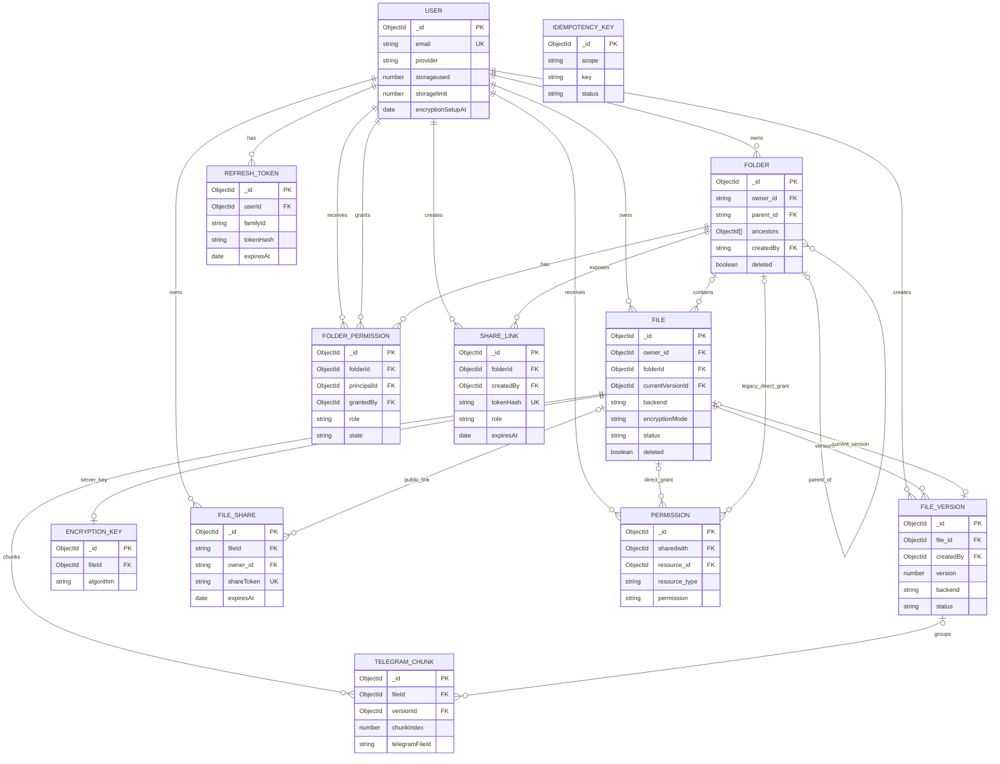

# StoreIt database ER diagram

This diagram documents the active Mongoose models in `adapters/database/models`.
Solid relationship labels describe the application's logical relationships;
some older schemas store IDs without Mongoose `ref` metadata.

Notes:

- `IdempotencyKey` is intentionally standalone; it protects retry-safe operations.
- `Permission.resource_id` is polymorphic (`file` or `folder`). Current folder sharing uses `FolderPermission` and `ShareLink`; `Permission` remains for direct file grants and legacy folder grants.
- `File.currentVersionId`, `Folder.owner_id`, `Folder.parent_id`, `FolderPermission.folderId`, and `ShareLink.folderId` are application-level references even where the schema does not declare `ref`.
